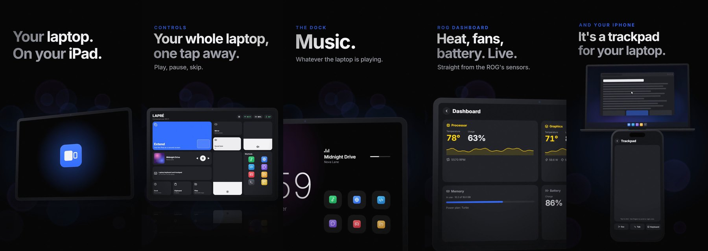

# Wingman

**Your iPad and iPhone, beside your Windows laptop.** A second screen, a
remote control and a desk clock in one free app. It connects over the cable,
over Wi-Fi, or from anywhere through Tailscale.

[](docs/wingman.mp4)

▶ [Watch the 40-second video](docs/wingman.mp4)

> A personal learning project: a Python "hub" on the laptop and a SwiftUI app
> on the iPad and iPhone, talking over a protocol of their own. It isn't on
> the App Store; you install it yourself with SideStore (free).

---

## What it does

**On the iPad**
- **Extend**: the iPad becomes a second screen, with touch and keyboard.
- **Sound**: the laptop's audio plays on the iPad.

**On the iPad and the iPhone**
- **Mirror**: the laptop's screen on the device, with touch.
- **A quick panel** over Extend and Mirror (shortcuts, controls, the
  clipboard) and a **keyboard button** to type into the laptop.
- **Controls**: volume, brightness, music, dark mode, Wi-Fi and Bluetooth,
  power plans, keeping the laptop awake.
- **Shortcuts**: one tap opens an app or website, runs a keyboard shortcut, or
  locks the laptop. They're editable on the device and show the real app icons.
- **Clipboard history and files**: copy on one side, paste on the other;
  send files both ways.
- **Dashboard** (ASUS ROG laptops): temperatures, fans, usage and battery
  health, live.
- **Dock**: a desk clock for the device standing beside the laptop. It shows
  what's playing, a volume line, your shortcuts, a timer with an alarm, and a
  red night mode. **Design your own Dock styles** in Settings (digital, flip or
  analog clock; colours; a glow, the song's cover or a plain background; what
  shows; the layout), and slide sideways on the Dock to switch between them.
- **Trackpad** (iPhone): the phone drives the laptop's pointer and keyboard.

**On the laptop**
- **Ctrl+Alt+I**: the laptop's own keyboard, touchpad and mouse control the
  iPad over Bluetooth, with the iPad's real trackpad gestures.
- **On-screen indicators** for whatever the device changes (volume, music,
  files received…).
- **A tray menu** listing the connected devices and how each is connected,
  with Disconnect.

**Connections:** the cable (fastest, pairs automatically), Wi-Fi (paired once
with a 6-digit code, then encrypted), and **Tailscale** for when you're away
from home. You tap **Connect** and watch each stage (looking, found, pairing,
securing, connected); in Settings each way can instead connect
**automatically**, or be switched **off**.

---

## What you need

| | |
|---|---|
| **Laptop** | Windows 11 (made and tested on it; Windows 10 may mostly work but is untested). An ASUS laptop for the temperatures and fans on the Dashboard; a Precision touchpad (most modern laptops) for Ctrl+Alt+I's real trackpad gestures. |
| **iPad / iPhone** | iPadOS / iOS 16 or newer. |
| **Free accounts** | An Apple ID (to sign the app with SideStore). Optional: Tailscale, for use away from home. |
| **Free software** | Apple Devices, the Parsec Virtual Display Driver, SideStore (all explained below). No Python needed with the installer. |

Wingman doesn't work with a Mac laptop: the laptop side uses Windows features.

---

## Setup

### 1. The laptop

1. **Download [Wingman-Setup.exe](https://github.com/angelorsbastos/wingman/releases/download/windows/Wingman-Setup.exe)**
   and run it. Windows may say *"Windows protected your PC"*, because the
   installer isn't signed with a paid certificate: click **More info → Run
   anyway**.
2. In the installer, choose what you'd like:
   - **Desktop icon**, and **Send to → iPad (Wingman)** in Explorer's
     right-click menu.
   - **The iPad 10's screen size** for Extend. Leave it off for another iPad
     (see *Another iPad model* below).
3. On the last page, the installer offers the two free drivers, but only the
   ones your laptop is missing:
   - **Apple Devices** (Microsoft Store): the USB service the cable connection
     needs. iTunes works too.
   - **The Parsec Virtual Display Driver**: it lets Wingman add a screen for
     Extend. Use the driver installer linked on that page; Wingman controls
     it.
4. **Start Wingman** (the installer can do it). It runs quietly in the system
   tray, bottom right; quit it from the tray icon.

**Another iPad model:** Extend uses the iPad's exact screen size. Download
[`pc/ipad-resolution.reg`](pc/ipad-resolution.reg), open it in Notepad, change
the two numbers and double-click it (needs admin). They're hexadecimal, so
Windows' Calculator in Programmer mode can convert them. For example, iPad Pro
11": 2388 × 1668 → `954` × `684`; iPad Pro 12.9": 2732 × 2048 → `aac` × `800`.

**Updating:** run the newest `Wingman-Setup.exe` (same link). Your pairings and
shortcuts are kept: they live in `%APPDATA%\Wingman`.

<details>
<summary><b>Running from the source code instead</b> (for developers)</summary>

1. Install **Python** 3.12 or newer from [python.org](https://www.python.org/downloads/)
   (tick **Add python.exe to PATH**), and clone the project:
   ```bash
   git clone https://github.com/angelorsbastos/wingman.git
   ```
2. In that folder, one at a time:
   ```bash
   python -m venv .venv
   ```
   ```bash
   .venv\Scripts\pip install -r requirements.txt
   ```
3. Install Apple Devices and the Parsec driver as above, and double-click
   `pc\ipad-resolution.reg` for the iPad 10's screen size.
4. Right-click `pc\make_shortcuts.ps1` → **Run with PowerShell** for the Start
   menu, desktop and Send to shortcuts, then start Wingman from the Start menu.
   Run this way, Wingman keeps its files in `pc\`.
5. To build the installer yourself:
   `.venv\Scripts\python.exe -m PyInstaller packaging\wingman.spec --noconfirm`,
   then compile `packaging\wingman.iss` with [Inno Setup](https://jrsoftware.org/isinfo.php).
   GitHub does both on every push (`.github/workflows/build-windows.yml`).

</details>

### 2. The iPad and iPhone

SideStore is the free way to install apps that aren't on the App Store. Its
[official guide](https://docs.sidestore.io) is the reference; in short:

1. **On the device:** install **LocalDevVPN** from the App Store and connect
   it. SideStore needs it whenever it installs, updates or refreshes apps.
2. **On the laptop:** install [iloader](https://iloader.app), plug in the
   device (unlocked; tap **Trust** if asked), sign in with your Apple ID and
   install **SideStore**. If the stable version won't sign in, use **Nightly**.
3. **On the device:**
   1. **Settings → General → VPN & Device Management** → tap your Apple ID →
      **Trust**.
   2. **Settings → Privacy & Security → Developer Mode → On**; the device
      restarts, then tap **Turn On**.
   3. Open **SideStore**, give it the **pairing file** if it asks (iloader:
      **Manage Pairing File**), and sign in with the same Apple ID. If anything
      goes wrong here, see [Troubleshooting](#troubleshooting).
4. In SideStore, **Sources → +**, and add:
   ```
   https://github.com/angelorsbastos/wingman/releases/latest/download/source.json
   ```
5. Install **Wingman** from that source and open it. Allow **Local Network**
   when it asks: that's how the laptop finds it on Wi-Fi.
6. **Once a week**, with LocalDevVPN connected, open SideStore and tap
   **Refresh All**. Apps signed with a free Apple ID stop opening after 7 days
   otherwise (nothing is lost: refresh and they work again).

SideStore signs the app with *your* Apple ID, and pairing is per device: your
copy only ever talks to your own laptop.

### 3. Connect

Make sure Wingman is running on the laptop (its icon is in the tray), open
Wingman on the device and tap **Connect**. The card shows each stage as it
happens, and what to check if it gets stuck.

1. **The first time, use the cable.** Plug the iPad (or iPhone) into the
   laptop, tap **Trust** on the device if asked, and tap **Connect**. It pairs
   by itself.
2. **From then on, Wi-Fi works too.** With both on the same Wi-Fi, tap
   **Connect**. To pair over Wi-Fi without the cable, type the 6-digit code the
   laptop shows. Guest networks often block devices from seeing each other;
   use the cable or Tailscale there.
3. **Away from home** (optional): install [Tailscale](https://tailscale.com) on
   the laptop and the device, signed in to the same account, and tap
   **Connect**.
4. **Don't want to tap Connect every time?** In **Settings → Connection**, set
   the ways you use to **Automatic**. **Off** ignores a way completely.

To disconnect: the plug button at the top of the home screen → **Disconnect**,
or on the laptop, the tray icon → your device → **Disconnect**.

### 4. Ctrl+Alt+I (the laptop's keyboard and touchpad on the iPad)

1. Press **Ctrl+Alt+I** on the laptop. A note at the top of the screen says
   it's connecting.
2. The first time only: on the iPad, open **Settings → Bluetooth** and tap
   the laptop's name (its Windows computer name).
3. Type, point, click, scroll, and swipe with three or four fingers like on
   an iPad trackpad. A plugged-in mouse works too. **Ctrl+Alt+I** again brings
   everything back to the laptop.

---

## Troubleshooting

**SideStore: signing in fails with error -80045.** Apple changed its login
checks and SideStore's default settings fail them. In **SideStore →
Settings**, with LocalDevVPN connected:
1. **User Customizations** → turn **off** *On-Device Anisette* (restart the app
   if it asks).
2. **Anisette Servers** → choose **SideStore (New)**, then scroll down and turn
   **off** *Enable Auto Rotation*.
3. **User Customizations → Anisette Client Configuration** → under **Remote
   Server Sync** tap **Fetch**, then **Save as Overrides**.
4. Back in **User Customizations**, tap **Reset adi.pb**.
5. Sign in again; it can take a little longer than usual.

**SideStore: "session expired" (or updates fail) on one device.** When two
devices use the same Apple ID, signing in on one can end the other's session.
On the device that complains: connect **LocalDevVPN**, then **SideStore →
Settings → Sign Out**, and **Sign In** again (with the -80045 fix above if that
error appears).

**SideStore says the pairing file is missing or wrong** (for example
"Device registration error"), even after iloader placed it. Some SideStore
versions don't recognise it. Make one with
[idevice_pair](https://github.com/jkcoxson/idevice_pair/releases):
1. Device plugged in and unlocked: open idevice_pair, pick the device, choose
   **Remote Pairing**, create the file, **Validate** it and **save** the
   `.plist`.
2. Get it onto the device (iCloud Drive or OneDrive → **Files** → move it to
   **On My iPad / iPhone**).
3. In SideStore, choose the pairing file and pick it.
4. Delete the cloud copy afterwards: a pairing file is a key to your device.

**SideStore stopped working after Tailscale was switched on.** iOS runs one
VPN at a time. SideStore needs **LocalDevVPN**; Wingman away from home needs
**Tailscale**. Switch to LocalDevVPN to refresh or update, then back.

**After a big iOS update, SideStore asks for a pairing file again.** Make a new
one with idevice_pair, as above.

**Wingman doesn't connect.**
- Is Wingman running on the laptop? Its tray icon's tooltip says what it's
  doing.
- Cable: is **Apple Devices** installed, and did the device **Trust** the
  laptop?
- Wi-Fi: same network (not a guest network), and **Local Network** allowed for
  Wingman in the device's Settings → Privacy & Security.
- Check **Settings → Connection** in the app: a way set to **Off** never
  connects.

---

## Updating

- **The app:** SideStore shows *Update available* whenever a new version is
  built; tap **Update**.
- **The laptop:** run the newest
  [Wingman-Setup.exe](https://github.com/angelorsbastos/wingman/releases/download/windows/Wingman-Setup.exe);
  it closes Wingman, updates it, and keeps your pairings and shortcuts. From
  the source code: `git pull`, then quit Wingman from the tray and start it
  again.

## Build your own copy

The iPad app is built for free on GitHub's macOS machines, so no Mac is needed:

1. **Fork** this repository.
2. In `ipad/make_source.py`, change `REPO` to your own `user/repository`.
3. Push a change under `ipad/`. GitHub Actions builds the app and publishes it
   as a release, together with your own `source.json`.
4. Add *your* source URL in SideStore (the same as above, with your
   `user/repository`).

If a build fails with *"The job was not acquired by Runner"*, GitHub had no
free Mac at the time: re-run it later. If it keeps happening, switch
`runs-on` in `.github/workflows/build-ipad.yml` between `macos-15` and
`macos-15-intel`.

---

## How it works

- **The laptop side** (`pc/`, Python) is the *hub*. It captures the screen
  (Windows Graphics Capture) and encodes it as H.264. It captures the sound
  (WASAPI loopback) and encodes it as AAC. It sends both to the device and
  carries out what the device asks for: input, shortcuts and controls.
- **The device side** (`ipad/`, SwiftUI, one universal app) decodes the video
  in hardware and the audio with AVAudioEngine. It sends touch, keyboard and
  trackpad input back.
- **Connections:**
  - **The cable:** usbmux, Apple's USB channel.
  - **Wi-Fi:** found by Bonjour, paired once with an X25519 key exchange and
    a 6-digit code. After pairing, every message is sealed with
    ChaCha20-Poly1305.
  - **Keys:** the laptop keeps them encrypted with the Windows account (DPAPI);
    the device keeps them in its Keychain.
- **Extend** adds a real screen to Windows through the Parsec virtual display
  driver.
- **Ctrl+Alt+I** makes the laptop a Bluetooth LE keyboard and Precision
  trackpad (HID over GATT), fed by the touchpad's raw fingers. The iPad then
  does its own pointer and gestures.
- **The video** in `video/` is made in code with [Remotion](https://www.remotion.dev);
  see `video/README.md`.

### Project layout

| Folder | What's in it |
|---|---|
| `pc/` | The laptop hub: `tray.py` starts it; `hub.py` is the core; one file per feature (`audio.py`, `controls.py`, `files.py`, `ipad_control.py`, …). |
| `ipad/` | The iPad and iPhone app (SwiftUI); `project.yml` describes the Xcode project. |
| `.github/workflows/` | The cloud builds: the app for SideStore, and the Windows installer. |
| `packaging/` | How the laptop side becomes `Wingman.exe` (PyInstaller) and `Wingman-Setup.exe` (Inno Setup). |
| `video/` | The showcase video's source. |
| `docs/` | The video and the picture at the top of this page. |

## Thanks

[Parsec VDD](https://github.com/nomi-san/parsec-vdd) for the virtual screen,
[SideStore](https://sidestore.io) for installing without the App Store,
[Tailscale](https://tailscale.com) for reaching home from anywhere, and
[Remotion](https://www.remotion.dev) for the video.
